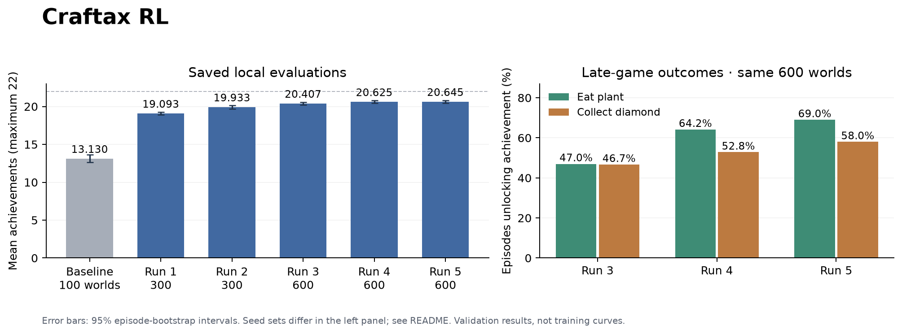

# Craftax RL

Training a survival agent with PPO, then studying what changes when it gets better rewards, a small amount of memory, and more practice in the late game.

I worked through five main experiments in a modified Craftax-Classic environment. The recorded external evaluation mean improved from a reference baseline of **13.2 to 20.77 achievements out of 22**. The largest gain came from more PPO training and a larger network. Later experiments addressed thirst, unsafe sleep, remembering a planted sapling, and the imbalance between early-game and late-game experience.

The useful result was understanding when extra machinery helped. Scripts initially complemented the policy, then became a source of interference as the network improved. Late-game practice improved the two hardest achievements, but the overall mean was almost unchanged.

## Results at a glance

| Experiment | Main change | Recorded external mean / 22 | Saved local mean / 22 | Local episodes |
|---|---|---:|---:|---:|
| Reference | PPO, 2 × 256 MLP, 15.9M steps | 13.20 | 13.130 | 100 |
| Run 1 | 3 × 512 MLP and 277M steps | 19.22 | 19.093 | 300 |
| Run 2 | Survival shaping and gated scripted routines | 19.96 | 19.933 | 300 |
| Run 3 | Selective shaping and plant-only intervention | 20.00 | 20.407 | 600 |
| Run 4 | Five reconstructed memory features | 20.71 | 20.625 | 600 |
| Run 5 | Late-game state reset curriculum | 20.77 | 20.645 | 600 |

**How to read this:** external means are historical measurements recorded in experiment notes, each over 100 episodes. External per-episode logs and seeds are unavailable. Local means above are recomputed from the JSON episode records included here. The baseline uses seeds 1000–1099; runs 1–2 use 2000–2299; runs 3–5 combine 2000–2299 and 3000–3299. Comparisons across different seed sets are descriptive. The +0.06 external difference between runs 4 and 5 does not establish a reliable improvement; their paired local mean difference is only +0.020.

Run `python scripts/summarize_results.py` to validate the archived data, check checkpoint hashes and regenerate the local table with bootstrap confidence intervals. Historical external results are in [results/recorded_benchmark.json](results/recorded_benchmark.json).



## Try a saved agent

Use Python 3.12. Training and evaluation use JAX/Flax; the saved policies themselves use NumPy.

```bash
git clone https://github.com/yogyam/craftax-rl.git
cd craftax-rl
python3.12 -m venv .venv
source .venv/bin/activate
python -m pip install -r requirements-repro.txt
python -m pip install -e .

# Validate the archived measurements and all six saved weight files.
python scripts/summarize_results.py

# Short integration check for the baseline and all five policy snapshots.
python scripts/smoke_check.py

# Evaluate from fresh worlds; this can take several minutes.
python scripts/evaluate.py policies/run5_curriculum \
  --episodes 100 --seed-start 4000 --workers 4 \
  --out local-results/run5_4000.json
```

The direct dependency versions in `requirements-repro.txt` match the original experiment environment. They are not a complete lock of transitive dependencies or accelerator builds. Reduce `--workers` if memory is limited. Use `--episodes 2 --max-steps 300` for a quick pipeline check; a truncated episode check is not a benchmark score.

## Environment and objective

Craftax-Classic is a partially observed survival and crafting game. Each episode ends at death or 10,000 steps. I evaluate the **arithmetic mean number of distinct achievements unlocked**, from 0 to 22. Shaping bonuses are used only for training; they do not contribute to this evaluation metric.

The observation contains 1,345 floats: a 7 × 9 local view with 17 block channels and four mob channels, inventory, health/food/drink/energy, facing direction, light and sleep status. There are 17 actions: movement, interaction, sleep, placement and tool crafting. Absolute position, elapsed time and a history of previous observations are absent.

All experiments use the same pinned Craftax version and parameter variant, defined in [src/craftax_rl/env.py](src/craftax_rl/env.py):

| Parameter | Value |
|---|---:|
| Day length | 240 |
| Cow / zombie / skeleton health | 4 / 7 / 4 |
| Night zombie spawn chance | 0.14 |
| Skeleton spawn chance | 0.07 |

These settings matter for interpretation: this is a Craftax-Classic variant, and the metric is an achievement count. The numbers should not be directly compared with published scores that use other parameters, aggregation methods or training budgets.

## The RL method

I used **Proximal Policy Optimization (PPO)** throughout. The algorithm stays the same across the five experiments; the changes are training budget, reward design, inputs and starting-state distribution.

The actor and critic share a tanh MLP. Runs 1–3 take 1,345 inputs, use three hidden layers of 512 units, and output 17 action logits plus one value estimate. Runs 4–5 take 1,350 inputs after adding memory features. At inference, the policy samples from the softmax distribution. The value output is used during training, not for selecting an action.

Each training iteration collects 64 steps from the vectorized environments. Generalized advantage estimation (GAE) compares observed rewards with the critic's predictions. PPO then increases the probability of actions with positive estimated advantage while clipping the probability ratio to limit update size. The loss also includes squared value error and an entropy bonus. Training uses `jax.vmap`, `jax.lax.scan` and JIT compilation; inference uses NumPy matrix multiplications.

| Setting | Main experiment configuration |
|---|---|
| Parallel environments | 1,024 |
| Rollout length | 64 |
| Batch size | 65,536 transitions |
| Update epochs / minibatches | 4 / 8 |
| Discount γ / GAE λ | 0.99 / 0.90 |
| PPO clip / value coefficient / entropy coefficient | 0.2 / 0.5 / 0.01 |
| Optimizer | Adam, ε = 1e-5, global gradient norm clipped at 0.5 |
| Learning rate | 3e-4 initially; lower for fine-tuning; linear wall-clock decay |

The trainer's defaults retain the smaller reference configuration, so use explicit flags for the larger experiments. [Training recipes](docs/training.md) document the progression, including the intermediate deficit-only fine-tune.

The native game reward includes achievement and health-change feedback. I added a small survival bonus in later runs. At γ = 0.99, rewards hundreds of steps away are heavily discounted: growing a plant takes about 600 steps, so that behavior is difficult to learn from a distant achievement alone.

### Why PPO and an MLP?

PPO provided a working reference implementation and efficient batched training. Keeping it fixed made it possible to investigate practical failure modes without also changing the optimization algorithm. A feed-forward network was inexpensive to train and deploy on CPU, but had no persistent memory. A recurrent policy was a plausible alternative; reconstructible features offered a cheaper warm-start path with a narrower capability.

## Baselines

The reference policy is a 2 × 256 tanh MLP trained for 15.9M environment steps. Its saved weights and trainer are in [baselines/ppo](baselines/ppo). Its local evaluation gives **13.13**, with a 95% episode-bootstrap interval of **[12.62, 13.61]** on seeds 1000–1099.

The original reference notes also report these external measurements. Their raw episode records are not included, so they are context rather than independently recomputed results:

| Reference behavior | Recorded mean | Recorded 95% CI |
|---|---:|---|
| PPO, sampled actions | 13.2 | [12.65, 13.75] |
| Same PPO, argmax actions | 12.3 | [11.83, 12.77] |
| Uniform random | 2.1 | [1.86, 2.36] |
| Always no-op | 0.0 | [0.0, 0.0] |

Sampling was retained because the reference comparison favored it. Later temperature tests also failed to produce a useful improvement. This is evidence for keeping the sampling setup in this project, rather than a claim that stochastic actions always outperform argmax.

## Five experiments and the decisions behind them

### Run 1 — Establish a stronger PPO policy

I increased the network from 2 × 256 to 3 × 512, used 1,024 parallel environments, annealed the learning rate, changed GAE λ to 0.90, and trained for roughly **277M steps over ten hours**. The recorded external mean reached **19.22**; the saved 300-episode local result is **19.093**.

The policy learned much more of the crafting progression. On the saved local set it crafted an iron sword in 70.3% of episodes, but ate a plant in only 1.3% and collected diamond in 2.3%. Average episode length was just 450 steps.

The decision was to establish a capable learned policy before building many special cases. The cost was substantially more compute. Width, depth, training duration and λ changed together, so this experiment does **not** isolate the contribution of any one of them.

Death diagnostics then suggested the next direction: the policy frequently collected the drinking achievement once and later died with drink at zero. Advancing the crafting tree was easier than consistently maintaining the resources needed to survive the long tail of the episode.

### Run 2 — Teach upkeep, then use rules selectively

I warm-started from run 1 and trained for another **77M steps**, adding **+0.1 on a step where food, drink or energy increased**. The implementation combines these conditions with OR, so it pays at most once per step, not once per stat or per unit restored.

I also tested a stateful wrapper: dead reckoning, a remembered map, path planning to water and plants, shelter construction and mountain exploration. Its critical restriction was delaying most interventions until the crafting progression was sufficiently advanced. Interrupting the network too early often caused it to lose the context needed to finish its tools.

On the same 300 local worlds, the run 1 policy scored **19.093**, shaped network alone **19.473**, and shaped network plus wrapper **19.933**. That separates a +0.380 training gain from a further +0.460 wrapper gain. Average lifetime increased to 1,158 steps; plant and diamond completion reached about 37% and 38%. The recorded external result was **19.96**.

The cost was a more complex controller and a shaping incentive that could be exploited by repeatedly topping up stats. Shelter searches and resource detours consumed time, and aggressive rules could sacrifice crafting achievements. The rules helped most when the network had learned basic survival but still lacked useful memory.

### Run 3 — Make shaping selective and retire most rules

A **253M-step intermediate fine-tune** paid upkeep bonuses only when the prior stat was at or below four. It recovered crafting and improved diamond discovery, but also let resources run too low; it did not improve the best wrapped result. This intermediate experiment is part of the training lineage, rather than a sixth main run.

I then used mixed shaping for about **192M additional steps**: always reward energy recovery, but reward food/drink recovery only when the prior stat was **≤ 5**. The idea was to keep the sleep incentive while reducing repeated top-up rewards for food and water.

At this point, the learned policy handled survival and exploration well enough that the full wrapper no longer consistently helped. On seeds 3000–3299, network alone scored **20.19**, full wrapper **20.31**, and plant-only intervention **20.50**. I kept the plant-return routine and lava mask, and disabled the other routines. The combined 600-world mean was **20.407**; the recorded external mean was **20.00**, illustrating how a smaller evaluation can differ from the local estimate.

The decision reduced controller interference. The remaining limitation was a hand-designed shaping schedule and a script for delayed plant harvesting. Mixed shaping improved the empirical balance; it is not potential-based shaping and does not guarantee preservation of the original reward's optimal policy.

### Run 4 — Give the policy a small, reconstructible memory

I appended five inputs: elapsed time / 10,000, whether a tracked plant exists, its clipped row and column offsets / 32, and age capped at 1,000 / 1,000. During training these come from environment state. During inference they come from observation history, dead reckoning and plant-event tracking; the policy never receives hidden environment state.

I padded the first layer with zero rows to preserve the previous network's initial outputs, then fine-tuned for about **245M steps** with a 6e-5 learning rate and mixed shaping. All scripted navigation and survival routines were disabled; **the lava mask and state tracking remain**.

The 600-episode local mean rose to **20.625**. Plant completion was 64.2%, diamond completion 52.8%, and average lifetime 3,921 steps. The recorded external mean was **20.71**. One local seed set suggested a much larger improvement than the other, so the combined estimate is the more useful comparison.

This provided task-specific memory without retraining a recurrent model from scratch. The cost is feature engineering and a possible training/inference mismatch: the tracker can drift or predict a plant before placement is confirmed. The historical checker found occasional planting-step discrepancies. [scripts/check_memory.py](scripts/check_memory.py) compares reconstructed and state-derived features; perfect equivalence is not assumed.

### Run 5 — Spend more experience on the late game

I warm-started from run 4 and trained for about **187M steps**, retaining memory inputs and mixed shaping. The trainer maintains a bank of up to 256 states captured when an agent acquires an iron sword while already owning an iron pickaxe. At an episode boundary it attempts a saved-state reset with probability **0.30**, using a fresh reset if the selected slot is not yet valid. PPO still learns from new on-policy rollouts after each reset; this is a starting-state curriculum, not replay of old action trajectories.

The target behaviors improved: plant completion increased from **64.2% to 69.0%**, diamond from **52.8% to 58.0%**, and the fraction reaching 10,000 steps from **8.8% to 17.5%**. But the mean moved only from **20.625 to 20.645** across the same 600 worlds. Other achievements offset the late-game gains. Re-enabling the plant routine reduced the mean again.

The recorded external mean, **20.77**, was the highest, but I treat this as an overall tie with run 4. The curriculum improved what it targeted while changing the training distribution. It did not solve the short episodes that still account for much of the remaining score gap.

## Evaluation and limitations

The evaluator loads a policy folder with `act(obs)` and optional `reset()`, starts each world from its seed, and steps until death or the cap. Each transition key is `jax.random.fold_in(world_key, t)`. It reports per-achievement rates, episode lengths, policy latency and a 95% bootstrap interval using 2,000 resamples.

Seeds 2000–2299 were used repeatedly for development and checkpoint selection. Seeds 3000–3299 were introduced as an additional check, then also informed later choices. **These are validation sets**, even though they are separate from training-world generation; neither should be described as an untouched final test. New seeds, such as the 4000+ example above, are the right next check. A single training lineage also leaves training-seed variance unmeasured.

Episode-bootstrap intervals describe variation across worlds for a fixed saved policy. They do not capture repeated tuning, training randomness or all uncertainty in the experiment. Approximate budgets come from the experiment notes; uninterrupted learning curves and optimizer-state checkpoints are not available. Warm starts restore weights, not an exact suspended training state.

The archived JSON includes more ablations than the six headline rows. Some intermediate policy snapshots are omitted, so those measurements can be inspected and recomputed from episode records but cannot all be rerun from a matching saved checkpoint. The five main snapshots and reference baseline are included, with weight hashes in [results/checkpoints.json](results/checkpoints.json).

### Changes that did not earn their complexity

- Broad survival scripting before the crafting tree was finished reduced iron-tool completion.
- Open-ground fort construction worked mechanically but did not improve the mean.
- Deficit-only shaping improved some crafting outcomes while weakening survival.
- Sampling-temperature changes did not produce a useful gain.
- The plant-return script hurt the final memory policies; the network had learned the behavior.
- Late-game resets improved plant/diamond completion but produced almost no overall mean gain.

The next experiment I would prioritize is reducing early deaths: in run 5, 17.5% of the saved episodes ended before step 500. A recurrent policy, a curriculum covering dangerous early states, and multiple independent training seeds would be more informative than adding another late-game rule.

## Repository layout

```text
baselines/ppo/             Reference network, weights and PPO trainer
policies/run1_ppo/         Larger PPO policy
policies/run2_shaped/      Survival-shaped policy with gated routines
policies/run3_selective/   Mixed shaping with plant-only intervention
policies/run4_memory/      Memory inputs; scripted routines disabled
policies/run5_curriculum/  Late-state reset curriculum
src/craftax_rl/            Environment parameters and bootstrap scoring
scripts/                  Train, evaluate, diagnose, trace and validate
results/evaluations/       Headline per-episode records
results/ablations/         Additional archived comparisons
docs/training.md          Commands and training lineage
docs/attribution.md       Upstream and assistance provenance
```

For wrapper ablations, policies expose environment variables such as `CRAFTAX_FLAGS="plant=0"`. Flags change behavior; record them alongside newly generated results. Runs 4–5 require their five memory inputs, so disabling `CRAFTAX_PLANT_FEATS` with those checkpoints causes an input-shape mismatch.

## References and attribution

- Schulman et al., [Proximal Policy Optimization Algorithms](https://arxiv.org/abs/1707.06347).
- Matthews et al., [Craftax: A Lightning-Fast Benchmark for Open-Ended Reinforcement Learning](https://proceedings.mlr.press/v235/matthews24a.html), ICML 2024; [official code](https://github.com/MichaelTMatthews/Craftax).
- The reference PPO implementation and checkpoint came from supplied starter code. The project extends that implementation rather than introducing a new RL algorithm. Original AI-assistance notes are retained; see [attribution](docs/attribution.md).
